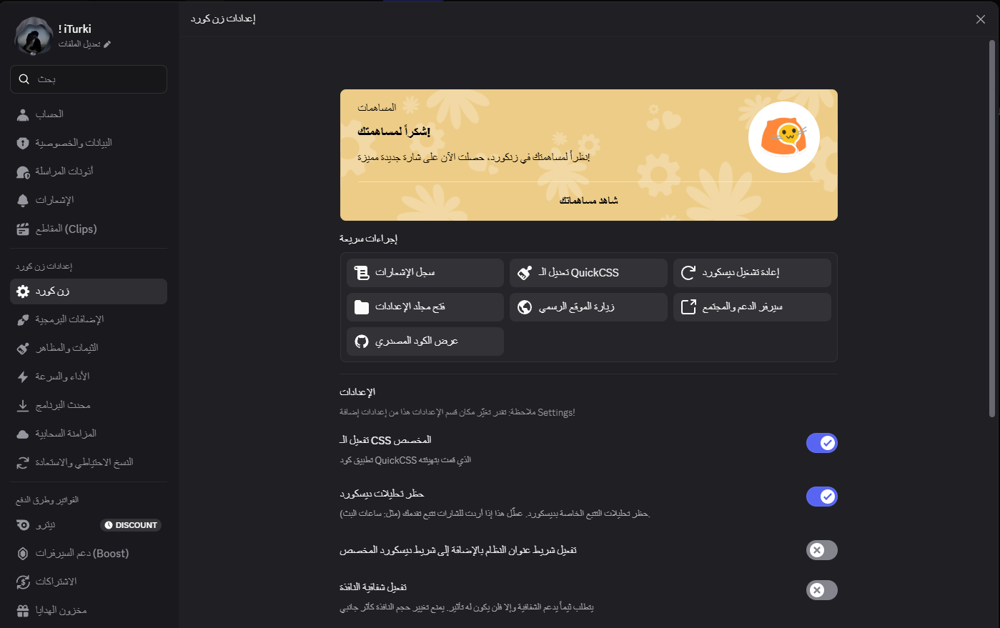

# ZenCord

The most advanced & lightweight Discord client mod

## Features

-   Easy to install
-   [100+ built-in plugins](https://www.zencord.site/)
-   Fairly lightweight despite the many inbuilt plugins
-   Native Arabic localization & typography support (دعم أصيل وكامل للغة العربية وتخصيص الخطوط)
-   Excellent Browser Support: Run ZenCord in your Browser via extension or UserScript
-   Works on any Discord branch: Stable, Canary or PTB all work
-   Custom CSS and Themes: Inbuilt Monaco CSS editor with support to import any CSS files (including BetterDiscord themes)
-   Privacy friendly: blocks Discord analytics & crash reporting out of the box and has no telemetry
-   Exclusive feature plugins: MicPro stereo studio, VoiceGuard, StreamProof, Quest Automator & more
-   Maintained very actively
-   Settings sync: Keep your plugins and their settings synchronised between devices / apps (optional)

## Installing / Uninstalling

Visit https://www.zencord.site/ or download the latest standalone installer directly from [Releases](https://github.com/turki-basha/ZenCord/releases/latest).

## Join our Support/Community Server

https://discord.gg/EYzpnZuSba

## Disclaimer

Discord is trademark of Discord Inc. and solely mentioned for the sake of descriptivity.
Mention of it does not imply any affiliation with or endorsement by Discord Inc.

Using ZenCord violates Discord's terms of service

Client modifications are against Discord’s Terms of Service.

However, Discord is pretty indifferent about them and there are no known cases of users getting banned for using client mods! So you should generally be fine as long as you don’t use any plugins that implement abusive behaviour. But no worries, all inbuilt plugins are safe to use!

Regardless, if your account is very important to you and it getting disabled would be a disaster for you, you should probably not use any client mods (not exclusive to ZenCord), just to be safe

Additionally, make sure not to post screenshots with ZenCord in a server where you might get banned for it

